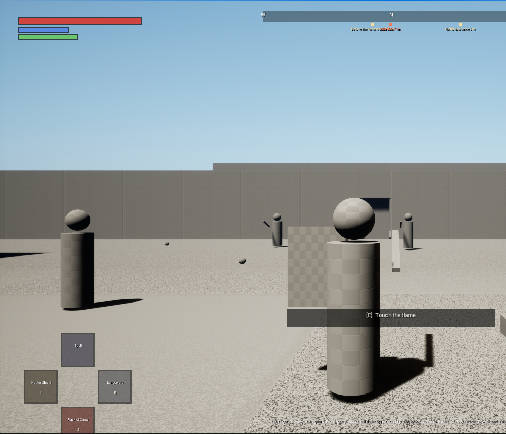
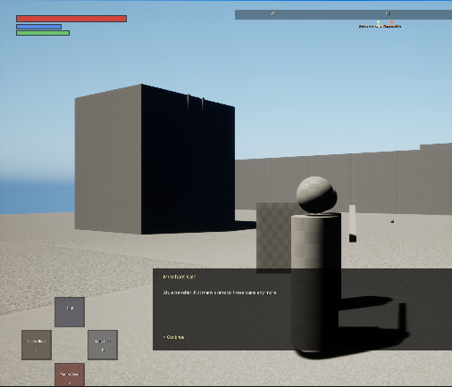
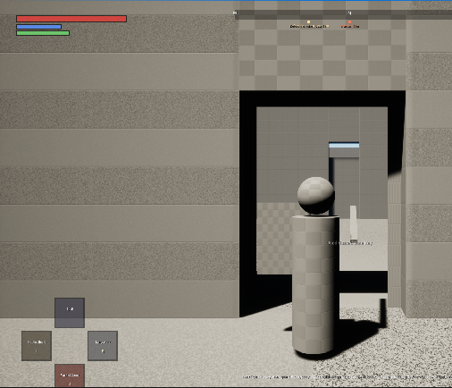
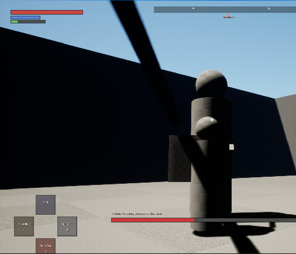

# Open Soulslike Framework (OSF)

**An open-source, C++-first, data-driven soulslike gameplay framework for Unreal Engine 5.8.**

Inspired by the feature set of the commercial
[Soulslike Framework](https://forums.unrealengine.com/t/soulslike-framework-complete-soulslike-kit/2443346).
OSF is an independent implementation written from scratch: no code or assets from that product are used.

[中文说明](#中文说明) · [Architecture](Docs/Architecture.md) · [Testing with MCP](Docs/MCP-Testing.md) · [Feature matrix](Docs/Features.md)

| | |
|---|---|
|  |  |
|  |  |

*Screenshots were captured by an AI agent driving the editor through UE 5.8's built-in MCP server. The demo uses only engine basic shapes.*

## Features

**Combat**
- Action system with an **input buffer**, combo chaining through cancel windows, stamina and FP costs
- Light combos, heavy attacks, running, jumping and **weapon skill** attacks per weapon moveset
- **Guard**, **perfect guard**, guard break, **parry**, **poise / stance break**, hyper armor, i-frame rolls and backsteps
  (roll distance and i-frames depend on equip load)
- **Ripostes** and **backstabs**, with critical damage multipliers per weapon
- Weapon blade traces (socket based or procedural), damage types, attribute scaling (E–S grades), requirements and two-handing
- Lock-on with target switching, line-of-sight and distance break
- Status effects with buildup and decay (bleed, poison, scarlet rot, frostbite), resistances, timed buffs and debuffs
- **Ranged weapons**: hitscan guns with ammo items, magazines, reload, ammo types (per-type damage vs. negation), pellets, spread and aim assist
- **Perilous attacks** that a matching hit source (e.g. a gunshot) counters, breaking the attacker's stance

**RPG**
- Stats and attributes (Vigor, Mind, Endurance, Strength, Dexterity, Intelligence, Faith, Arcane), a level-up cost curve, stacked modifiers
- Inventory, a storage chest, flasks refilled at rest, consumables, key items, crafting recipes
- Equipment: 3 right-hand and 3 left-hand weapons, head/chest/arms/legs armor (modular meshes via leader pose), talismans, 5 quick items, equip load
- Currency drops on death as a **bloodstain** you can recover; dying again loses it

**World**
- **Resting points**: rest, level up, refill flasks, respawn enemies, set the respawn point, autosave, pass time
- Doors (key / progress / one-way), chests, item pickups, ladders, boss **fog gates**
- **NPC dialogue driven by progress** (gameplay tags or name flags), vendors with limited stock, buy and sell
- Tag-based progression, slot-based **save & load**, time of day, a compass with markers
- **Quests** with kill / flag / item objectives and rewards, saved through the progression flags

**AI**
- Perception plus a self-contained state machine (idle, patrol, combat, return, leash) that needs no navmesh or behavior tree (both are optional)
- Weighted ability selection by range, cooldown and boss phase; combo follow-ups; reactive guard and dodge; whiff punishing
- **Multi-phase bosses** with phase buffs, a boss bar, music and defeat progression

**Presentation and tooling**
- Default canvas HUD and gamepad-navigable menus (rest, level up, inventory, equipment, crafting, storage, shop, dialogue, save/load). A UMG front-end can use the same controller API.
- Works **with zero art**: without a skeletal mesh, characters render as procedural bodies with procedural swings, rolls, guard, stagger and death. Assign a mesh and montages and the anim notifies take over (`OSF Weapon Trace`, `OSF I-Frames`, `OSF Hyper Armor`, `OSF Input Buffer`, `OSF Parry Window`, `OSF Adjust Stat`).
- **Imported characters without anim blueprints**: `UOSFClipAnimInstance` plays trimmed clips (idle / walk / run by speed, action clips),
  `SetupSkeletalMesh` sizes and grounds glTF / Tripo rigs, unrigged scans can be bodies; NPCs can use skeletal bodies too.
  Held guns get an **aim pose**: the torso turns so the barrel (the mesh's long axis) points at the lock-on target, with a recoil kick per shot.
- **Runtime translations** of the framework UI from a JSON table (CJK glyphs supported by the default HUD font).
- Debug console commands (`OSFStatus`, `OSFAction`, `OSFGoTo`, `OSFInteract`, `OSFGod`, `OSFSave`…) make every system scriptable
- **Autopilot** (`UOSFAutoPilotComponent`): plays a scripted route through the player's own input paths - walks, fights
  (lock-on, spacing, shooting or swinging, rolls out of wind-ups, gun counters on perilous attacks, heals), rests, talks,
  opens doors - for recorded playthroughs and end-to-end playtests without a human at the controls (`OSFAutoPilot start`)
- 13 automation tests, plus an MCP-driven end-to-end walkthrough

## Requirements

- Unreal Engine **5.8** (Windows tested), Visual Studio 2022 / Build Tools
- No marketplace content needed. The demo builds its level at runtime from `/Engine/BasicShapes`.

## Quick start

```bash
git clone https://github.com/lifecoder1988/open-soulslike-framework.git
```

1. Right-click `OSFDemo.uproject` → *Generate Visual Studio project files* (or just open it and let UE build the modules).
2. Open the project, then press **Play**. The demo game mode builds the arena on the empty `/Engine/Maps/Entry` map.

| Action | Keyboard / mouse | Gamepad |
|---|---|---|
| Move / camera | WASD / mouse | Left / right stick |
| Light / heavy attack | LMB / Q | RB / RT |
| Guard / skill (parry with a shield) | RMB / F | LB / LT |
| Roll (tap) / sprint (hold) | Space | B |
| Jump | C | Y |
| Lock-on | Middle mouse / Tab | R3 |
| Use item / interact | R / E | X / A |
| Cycle right / left / quick item, two-hand | 1 / 2 / 3, T | D-pad |
| Menu | I (Esc) | Start |

## Using the plugin in your project

Copy `Plugins/OpenSoulslikeFramework` into your project's `Plugins/` folder, then:

1. Set your game mode to `OSFGameMode` (or a subclass). It provides `OSFPlayerCharacter`, `OSFPlayerController` and `OSFHUD`.
2. Place `OSFRestingPoint`, `OSFEnemyCharacter`, `OSFDoor`, `OSFContainer`, `OSFLadder`, `OSFNPC` and `OSFFogGate` actors in your level.
3. Create **Data Assets** for items (`OSFWeaponData`, `OSFArmorData`, `OSFTalismanData`, `OSFItemData`), buffs, status effects, dialogue, vendors and recipes.
4. Optional: assign a skeletal mesh, an anim BP, montages per attack (`FOSFAttackDefinition::Montage`), and the OSF anim notifies.

See [Docs/Architecture.md](Docs/Architecture.md) for the component overview and extension points.

## Testing (including via MCP)

- Headless: `UnrealEditor-Cmd OSFDemo.uproject -ExecCmds="Automation RunTests OSF;Quit" -unattended -NullRHI`
- AI agents: the project auto-starts UE 5.8's built-in **MCP server** at `http://127.0.0.1:8000/mcp`
  (`.mcp.json` is included for Claude Code). `Tools/MCP/osf_walkthrough.py` plays the whole demo through MCP:
  merchant, shop, key, gate, ladder, rest, two-phase boss, save/load. See [Docs/MCP-Testing.md](Docs/MCP-Testing.md).

## License

MIT, see [LICENSE](LICENSE). Unreal Engine is a trademark of Epic Games; use of the engine is subject to the Unreal Engine EULA.

---

## 中文说明

**Open Soulslike Framework（OSF）** 是一个基于 Unreal Engine 5.8 的开源类魂游戏框架，以 C++ 为主、数据驱动。
功能清单参考了商业插件 [Soulslike Framework](https://forums.unrealengine.com/t/soulslike-framework-complete-soulslike-kit/2443346)，但所有代码均为独立重写，没有使用该产品的任何代码或资源。

### 已实现的系统

- **自动驾驶**：`UOSFAutoPilotComponent` 按脚本走路线、打怪（锁定、拉距离、射击 / 挥砍、读前摇翻滚、危招枪反、回血）、休息、对话、开门，用于录制通关视频和无人端到端测试
- **战斗**：动作系统、输入缓冲、连招、轻/重/冲刺/跳跃攻击、武器战技、格挡、完美格挡、破防、弹反、架势（Poise）崩溃、霸体、翻滚无敌帧、背刺、处决（Riposte）、武器轨迹检测、伤害类型与属性补正（E–S）、双持、锁定
- **状态异常与 Buff**：出血、中毒、腐败、冻伤（积累与衰减）、抗性、计时 Buff/Debuff
- **RPG**：8 项属性、升级、背包、仓库、原素瓶（休息时补满）、消耗品、钥匙、制作配方、装备（左右手各 3 把武器、四件护甲、护符、5 个快捷道具）、负重
- **世界**：赐福点/篝火（休息、升级、补瓶、刷新敌人、存档）、门（钥匙/进度/单向）、宝箱、拾取物、梯子、Boss 雾门、死亡掉落的血迹（可回收）
- **NPC**：按进度变化的对话、可限量的商店（买/卖）
- **枪械与危招**：命中扫描枪械、弹药物品与弹匣、换弹/切换弹种、弹丸/散布/辅助瞄准；危招（Perilous）可被指定来源（如子弹）识破打断
- **任务**：击杀 / 标记 / 物品目标与奖励，状态存进进度系统随存档保存
- **导入角色免动画蓝图**：`UOSFClipAnimInstance` 直接播放裁剪片段（待机/走/跑按速度混合 + 动作片段），适配 glTF / Tripo 骨架；未绑骨模型可作静态身体
- **运行时翻译**：用 JSON 表翻译框架界面文字，HUD 字体自带中日韩字形回退
- **进度/存档**：基于 Gameplay Tag 的进度系统、多槽位存档读档、昼夜系统、指南针标记
- **AI**：感知加内置状态机（不依赖 NavMesh 或行为树），按距离/冷却/阶段加权选招、连段、格挡与闪避反应、多阶段 Boss
- **界面**：默认 Canvas HUD 和可用手柄操作的菜单，菜单逻辑与渲染分离，便于替换成 UMG
- **零美术资源也能玩**：没有骨骼网格体时自动用程序化身体和动作表现；配上网格体和蒙太奇后，由动画通知（Anim Notify）驱动

### 快速开始

1. 安装 UE 5.8 和 VS2022，然后克隆本仓库。
2. 打开 `OSFDemo.uproject`，等模块编译完成后点击“运行”。演示地图会在运行时自动搭建。

### 通过 MCP 测试

项目启用了 UE 5.8 自带的 **Model Context Protocol（MCP）服务器**，编辑器启动后自动监听 `http://127.0.0.1:8000/mcp`，仓库里也附带了 `.mcp.json`。
Claude Code 等 AI Agent 可以通过它：

- 运行全部自动化测试（`AutomationTestToolset`）
- 启动 PIE、截图（`EditorAppToolset`）
- 在编辑器控制台输入 `OSF*` 调试命令（`SlateInspectorToolset`），驱动实际玩法
- 触发 Live Coding 热编译

`Tools/MCP/osf_walkthrough.py` 会通过 MCP 自动通关演示关卡（共 10 项检查），详见 [Docs/MCP-Testing.md](Docs/MCP-Testing.md)。
